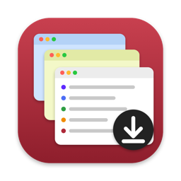
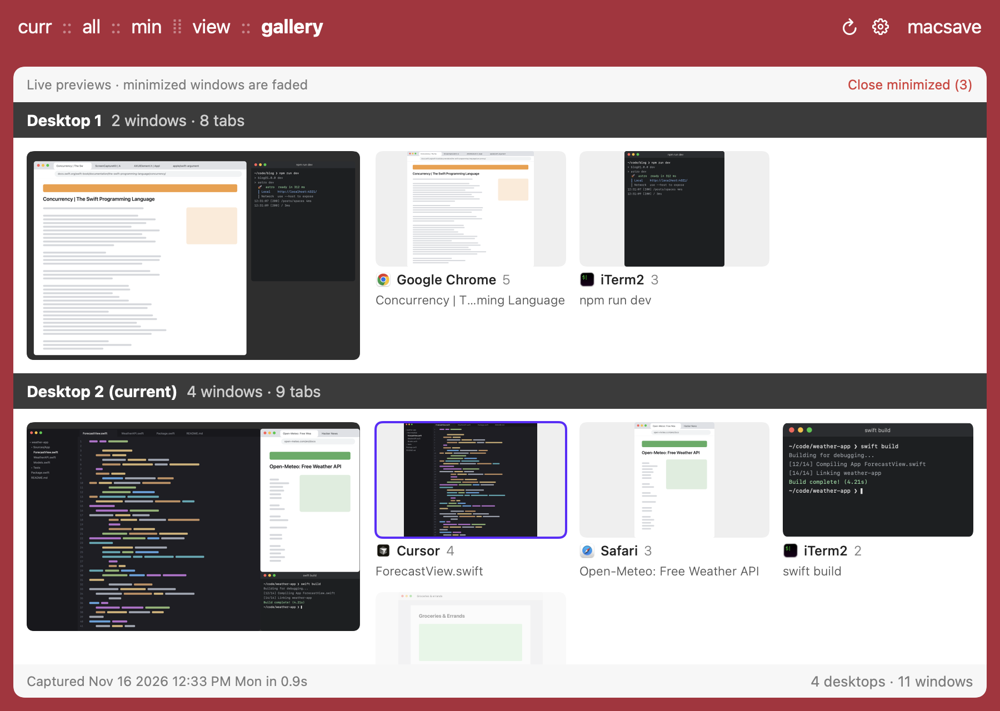
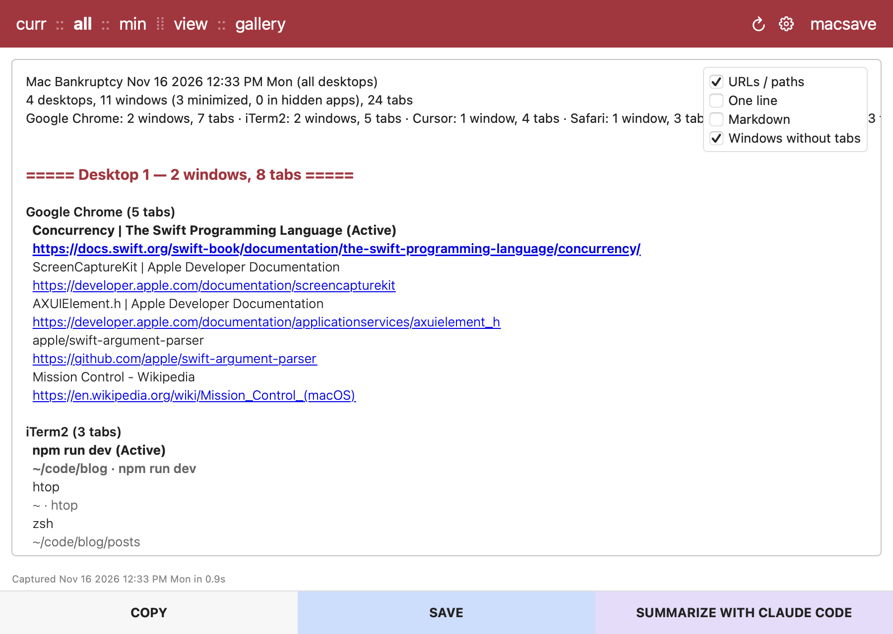
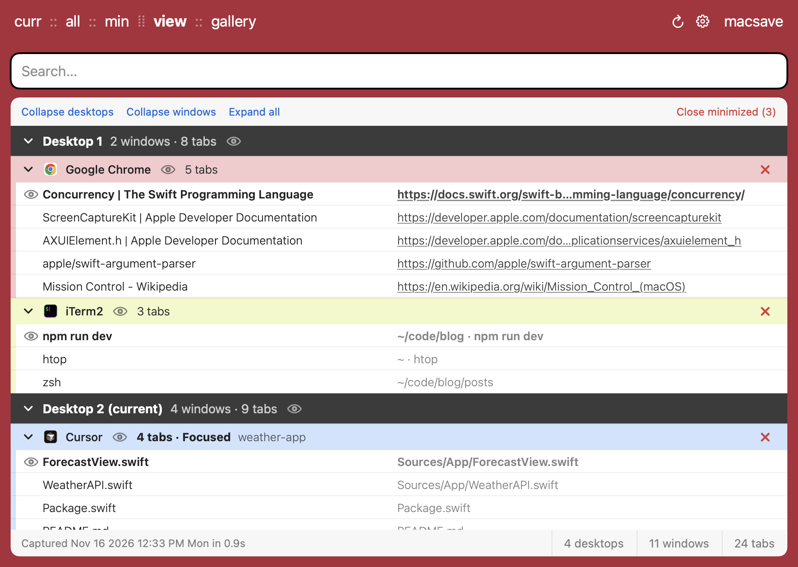

#  MacSave

Tabsave for the whole Mac: a menu-bar app that snapshots every app's windows and tabs,
grouped by macOS desktop (Space), and saves them to a note in one click — e.g.
`~/projects/notes/2026/2026-11-16/closing-windows-1233.txt`. Optional "Summarize with AI"
prepends a summary from the local `claude` or `codex` CLI.



| Text export (`all`) | Tree (`view`) |
|---|---|
|  |  |

Tabs: **curr / all / min** are the text export for the current desktop, every desktop, or only minimized and hidden windows (Copy, Save, Summarize).
**view** is a searchable, collapsible tree with ✕ buttons. **gallery** shows each desktop's composite next to previews of its windows; minimized windows are faded.
*Close minimized* (in view and gallery) closes every minimized window after a second click to confirm.

Screenshots use built-in fake data: `MacSave --demo` runs the app with it, and
`.build/debug/MacSave --demo --screenshot docs/screenshots` re-renders these images.

## Build / run

```sh
./build.sh --install        # builds, signs, copies to ~/Applications, launches
swift build && .build/debug/MacSave --help   # CLI mode (same binary)
```

CLI: `MacSave --print [--markdown] [--one-line] [--no-urls] [--tabs-only] [--scope all|current|minimized] [--summarize claude|codex] [--save [template]] | --json`.
`MACSAVE_DEBUG=1` prints per-app timing.

## Permissions

- **Accessibility** — window titles, minimized state, windows on other desktops, native tabs (Finder etc.).
- **Automation** (prompted per app on first scan) — tabs from Chrome-family/Arc/Safari, iTerm2, Terminal, Finder.
- **Screen Recording** (optional) — eye-icon previews and the gallery tab.
- Without Accessibility it still works via CoreGraphics + AppleScript, with less detail.

## Where the data comes from

| Source | Gives |
|---|---|
| `CGSCopyManagedDisplaySpaces` / `CGSCopySpacesForWindows` (private, read-only) | desktops, which desktop each window is on |
| CoreGraphics window list | every window incl. other desktops, bounds, z-order |
| Accessibility (+ remote-token enumeration for other desktops, like AltTab) | titles, minimized, native tab groups |
| JXA via `osascript` | browser tabs (title+URL), iTerm/Terminal tabs (tty → cwd + foreground command via `ps`/`lsof`), Finder paths |
| Cursor/VS Code `workspaceStorage/*/state.vscdb` | open editor tabs per workspace (as last persisted — may lag a minute) |
| Sublime `Auto Save Session.sublime_session` | open tabs per window (as of last session autosave) |

Script windows are matched to real windows by bounds + title; unmatched ones land under "Desktop unknown".

## Closing

The view tab has ✕ buttons: windows close via AppleScript (browsers) or the Accessibility close button;
Chrome-family/Safari tabs close individually.

## Not done yet / ideas

- Chrome tab groups, Arc spaces, Warp/Ghostty tabs, JetBrains, Xcode projects.
- Global hotkey; restore a saved session.

The app icon is drawn by `swift scripts/make-icon.swift Resources/AppIcon.icns docs/icon.png`.

## License

MIT
